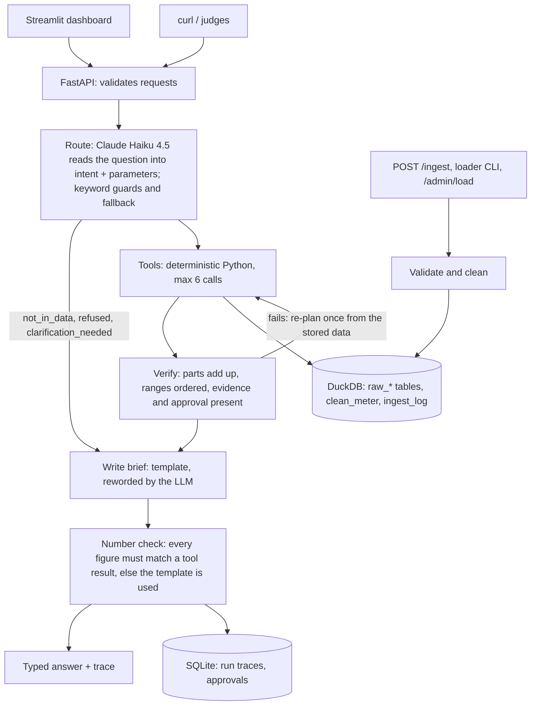

# Factory Energy Cost Decomposition and Savings Agent

The factory's electricity bill rose 15%. This system says **why**, **what the factory can control**, and **what to fix first**:

- It splits the rise into tariff, volume, product mix, weather and new waste. The parts add up to the total, and each comes with a range.
- It finds controllable waste from the meter data, with evidence: a compressed-air leak, hall lights left on overnight, HVAC running on Sundays.
- It turns each waste pattern into an action with yearly ₹, kWh and CO2e savings, each as a range. Actions are ranked by ease, then saving, and a manager approves them. No payback is given: the data has no implementation costs, and the system says so rather than assume them.
- It answers questions in plain words, quoting only numbers the tools computed. When the data cannot answer, it says so.

On the bundled sample, it explains the 15.03% rise as 12.98 points outside the factory's control and 2.05 points of new waste (a compressor leak that started on 20 July). It finds ₹19–23 lakh a year of savings across three easy actions.

HCLTech Future Ready AI Engineer Hackathon, Factory Energy track.

## Quick start

```bash
uv venv -p 3.11 .venv && uv pip install -p .venv/bin/python -r requirements.txt   # or: python3.11 -m venv .venv && .venv/bin/pip install -r requirements.txt
cp .env.example .env              # set AWS_PROFILE to a profile with Bedrock access, or MOCK_LLM=true
export PYTHONPATH=src
.venv/bin/python -m energy.generate --out data --seeds 1 2 3 --control --stress
.venv/bin/python -m uvicorn energy.api:app --app-dir src --port 8000 &
.venv/bin/python -m energy.loader data/seed_1          # prints the six validation checks
.venv/bin/python -m streamlit run ui/app.py            # http://localhost:8501
```

With Docker (Bedrock credentials are mounted read-only from `~/.aws`; the image never contains them):

```bash
docker compose up --build         # API on :8000, UI on :8501; loads the synthetic sample on first start
docker compose exec api python -m energy.loader /app/data/<folder>      # load a folder of CSVs (judges' data)
```

## Using the dashboard

The dashboard opens on the answer; nothing needs typing.

| Tab | What it shows |
| --- | --- |
| **Overview** | Headline figures (bill, points outside our control, new waste, savings found, CO2e avoidable). The bill-bridge chart: blue causes are outside the factory's control, the orange one is controllable. Also a short brief written by the LLM from verified figures, and the top three actions. |
| **Ask a question** | Plain-language questions, with suggested ones. Each answer shows its type, the right chart, its assumptions and limits, and "how this was worked out" (the trace). |
| **Savings plan** | Every action ranked by ease, then saving, with ₹, kWh, CO2e, evidence and **Approve / Reject** buttons. |
| **Where the energy goes** | Energy by asset and daily cost (tariff rise marked). For each asset: its average day against the level it should drop to outside the shift, a weekday × hour heatmap, and night load day by day (the leak's start is marked). |
| **Data** (menu in the header) | The six validation checks, what cleaning changed, file upload, and one-click **Apply the late data drop**. |

After new data loads, a banner says what moved. For the late drop: *"The bill rise moved from 15.44% to 15.03% (tariff −0.41 pts)"*, and line_2 reads 7.4% less after recalibration.

## Architecture



| Layer | Choice | Where |
| --- | --- | --- |
| UI | Streamlit, light theme, Plotly | `ui/app.py`, `ui/charts.py`, `.streamlit/config.toml` |
| API | FastAPI, Pydantic v2 | `src/energy/api.py` |
| Orchestration | LangGraph: route → tools → verify → write → number check | `src/energy/agent.py` |
| Analytics | pandas, numpy | `src/energy/analytics.py` |
| Validation, cleaning, ingest | pandas | `src/energy/pipeline.py` |
| Store | DuckDB (data in raw, clean and log layers), SQLite (traces, approvals) | `src/energy/store.py` |
| LLM | Claude Haiku 4.5 on Amazon Bedrock (`LLM_PROVIDER=bedrock`); `anthropic` or `mock` also work | `src/energy/llm.py` |
| Vector store | Not used: nothing here needs retrieval | |

**Why this shape.** Every number is computed by code. The LLM does two narrow jobs: reading a question into a structured request (JSON schema output), and rewording a brief built from tool results. Both are checked. Routing is guarded by deterministic rules for refusals and unsupported scenarios, and the number check rejects any figure no tool produced. There is one agent, not several: the steps after routing are deterministic, so extra agents would add cost and failure modes without adding capability.

## API

| Endpoint | Purpose |
| --- | --- |
| `POST /analyze` | `question`, optional `period` and `compare_to` (for example `2026-Q3`). Returns `run_id`, `answer_type`, `summary`, `bridge`, `recommendations`, `data`, `assumptions`, `limitations` |
| `POST /ingest` | Multipart CSV `file` plus `table`, or `meta` JSON such as `{"table": "tariff"}`; optional `mode` `auto` or `replace`. Returns `rows_loaded`, `rows_rejected`, `status`, what was changed, and the validation output |
| `GET /health` | API, data store (DuckDB) and LLM status; the LLM is pinged, with the result cached for 5 minutes |
| `GET /trace/{run_id}` | Every step, tool, input and output, LLM calls, tokens, latency, model and data version |
| `GET /validation` | Six checks, cleaning report and load history |
| `GET /dashboard`, `GET /profile/{asset}` | Read-only data for the dashboard |
| `POST /actions/{action_key}/decision` | Manager's decision on an action: `approved`, `rejected` or `pending` |
| `POST /admin/load`, `/admin/late-drop`, `/admin/reset` | Load a server-side folder or the synthetic sample, apply its late drop, or clear the data |

```bash
curl -s -X POST localhost:8000/analyze -H "Content-Type: application/json" -d '{"question": "Why did the bill go up 15%?"}'
curl -s -X POST localhost:8000/analyze -H "Content-Type: application/json" -d '{"question": "What should we do first?", "period": "2026-Q3", "compare_to": "2026-Q2"}'
curl -s -X POST localhost:8000/ingest -F "file=@data/seed_1/late_drop/tariff.csv" -F 'meta={"table": "tariff"}'
curl -s localhost:8000/health
curl -s localhost:8000/trace/en-xxxxxxxx
```

**Safe ingest.** Data can be updated while the system is running, without losing or mixing it:

- A tariff file replaces the schedule.
- A file with the main meter plus several sub-meters, or one covering most of the period, replaces the table.
- One meter's full series replaces that meter only (the late recalibration).
- Anything shorter updates matching rows and adds new ones.

The same file twice changes nothing. A meter with more than 5% missing intervals is flagged, and if the main meter is mostly missing, no cost figure is given.

## Method

1. **Clean.** Drop duplicates, treat negative readings as meter resets, fill gaps of up to 2 hours by interpolation and longer ones from the typical profile (same quarter, day type and time of day). Everything changed is counted.
2. **Price.** Each 15-minute interval is priced by its timestamp, so the mid-quarter tariff change is exact.
3. **Tariff effect.** Current energy at actual prices minus the same energy at reference-quarter prices.
4. **Baseline.** A linear model of daily cost at reference prices, fitted on the reference quarter. Its inputs are working-day and idle-day base load, units of each product, and degree-days on working days.
5. **Volume, mix, weather.** Each driver's effect is averaged over every ordering (Shapley), so the split does not depend on order.
6. **New waste.** What the four effects above do not explain, so the parts always add up. When its range includes zero, the answer says no new waste can be confirmed and no machine is blamed.
7. **Ranges.** The 5th to 95th percentile of 200 bootstrap refits of the baseline.
8. **Waste with evidence.**
   - *New waste:* a sub-meter whose night load steps up and stays up (the leak, from 20 July).
   - *Off-hours waste:* load at night, or during shift hours on Sundays and holidays, above what that kind of asset needs (an assumed benchmark share of its shift load).
9. **Savings.** Avoidable kW × the hours it runs per year × the tariff in that window, with low and high values. Actions are ranked by ease, then by yearly saving. Payback is not computed because the data has no implementation costs; a payback question gets that answer, not a guess.

## Evaluation

The analytics evaluation (`python -m energy.evaluate` → `eval/report.md`) runs five generated datasets with known truth: three seeds, a no-waste control, and a stress set with a curved weather response.

| | OLS (chosen) | Ridge |
| --- | --- | --- |
| Mean error per cause (points) | 0.05 | 0.20 |
| Worst single error (points) | 0.27 | 0.61 |
| Truth inside the stated range | 42 of 50 | 24 of 50 |
| Planted waste patterns found | 3 of 3 on every waste dataset | same |
| False waste claims (control set included) | 0 | 0 |
| True saving inside the stated range | 3 of 3 on every waste dataset | same |

The agent evaluation (`python -m energy.eval_agent --configs mock haiku sonnet` → `eval/agent_report.md`) runs 27 cases through the whole path:

- 5 questions where price or mix, not machines, is the answer
- 5 numeric questions checked against independent sums of the raw CSVs
- 3 what-ifs
- 4 waste and savings questions
- 4 questions the data cannot answer
- 3 attempts to make it invent a number
- 1 clarification, 1 late-drop question and 1 wrong premise

Checks are exact, in code; there is no LLM judge.

| | Templates only | Claude Haiku 4.5 (chosen) | Claude Sonnet 4.6 |
| --- | --- | --- | --- |
| Cases passed | 27/27 | 27/27 | 27/27 |
| Number faithfulness of final answers | 100% | 100% | 100% |
| LLM figures caught by the number check | – | 0 | 8 |
| Latency p50 / p95 | 4 / 7 ms | 2.0 / 3.9 s | 1.6 / 4.0 s |
| LLM calls and tokens per request | 0 | 1.37, 2,216 | 1.37, 2,225 |

Haiku is the default. It matched Sonnet's accuracy, and the number check never had to replace its wording; Sonnet added figures 8 times, which were caught and replaced by the template. The template-only mode passes the same set because the keyword router handles these phrasings; the LLM's value is in reading phrasings the keywords miss, and in a more readable brief.

**Read with care.** The generator and the baseline were written by the same team, so the seed datasets are an easy test. The stress set is the more honest one (0.11 points mean error; weather is off by 0.27 points because its response is curved).

## Data

`python -m energy.generate` writes the four Annex B files plus a late-drop folder, a private `truth.json`, and a data card (`data_card.json` and `DATA_CARD.md`, Annex D). It is synthetic: a numpy generator with fixed seeds, and no real data. Traps planted on purpose:

- a tariff rise mid-quarter, with a wrong off-peak price corrected by the late drop
- line_2 reading 8% high until the late drop recalibrates it
- a product-mix shift towards a more energy-intensive product
- a hot period in September
- a public holiday logged as a normal shift
- unmetered load, two outages, random gaps, 200 duplicates and a meter reset
- three controllable waste patterns: the compressed-air leak (new from 20 July), lights on at night, and HVAC on Sundays and holidays

## Assumptions

- The tariff schedule in force during the reference quarter is the "old" price for every interval.
- Peak hours come from the tariff's `start_hour`/`end_hour` columns (extra columns are allowed by Annex B); without them, peak is 06:00–22:00.
- The shift is 06:00–22:00 (`SHIFT_HOURS`). A day is a working day only if units were produced and it is not a holiday.
- Emission factor: 0.71 kg CO2e per kWh, read from the data card (an assumed grid average).
- The expected off-hours load of each kind of asset and each action's ease are stated rules of thumb (`OFF_HOURS_BENCHMARK` and `ACTION_LIBRARY` in `analytics.py`). The data has no cost table, so no cost or payback is given.

## Limitations

- Ranges cover fit error only, not a wrong model form. A curved weather response is partly misattributed (see the stress set).
- Intraday load shape is the same in both quarters, so shifting load to off-peak hours is not modelled.
- Scenarios for a different production volume are not modelled. The tool says so instead of guessing.
- The factory clock is taken as UTC.
- DuckDB allows one writer, so the loader goes through the running API when it is up.

## Tests

`python -m pytest -q`: 49 tests covering the schema, cleaning, validation, the bill split against truth, waste and savings against truth, the control set, ranking, safe ingest, the API contract and 20 answer types, premise correction, the what-ifs, the number check, LLM fallback, the dashboard, approvals and the late drop.

Sample traces for four answer types are in `eval/traces/`.

## AI-usage disclosure

The code, tests and documentation were written with Claude Code (Anthropic), working from the participant guide and the team's design document. They were verified with the test suite, the two evaluations against known truth, live API runs with Claude on Bedrock, and screenshots of the running dashboard. Team members must read and be able to explain every module before submission.

## Team contribution

| Member | Area |
| --- | --- |
| [Name 1] | Analytics core: baseline, bridge, waste, savings |
| [Name 2] | API, agent and LLM layer |
| [Name 3] | Data generator, validation, evaluation |
| [Name 4] | Dashboard and delivery |
