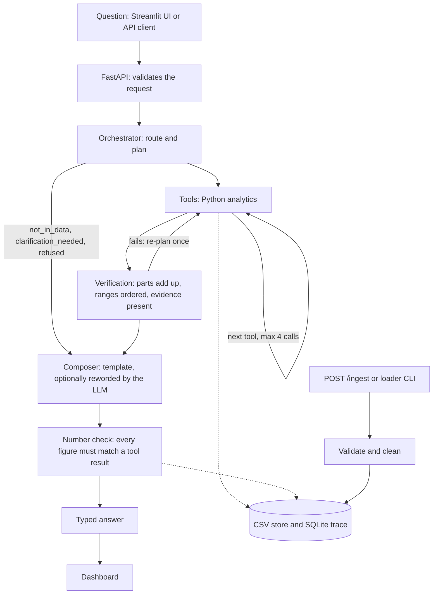

# Factory Energy Cost Decomposition and Savings Agent

Explains why a factory's electricity bill changed between two quarters. It splits the change into tariff, volume, product mix, weather and waste so the parts add up to the total, finds controllable waste with evidence, and suggests actions with savings ranges and payback.

Every number is computed by code. The LLM only labels requests the keyword router cannot place and rewords two kinds of brief; a number check blocks any figure that no tool produced.

HCLTech Future Ready AI Engineer Hackathon, Factory Energy track.

## Status

| Part | State |
| --- | --- |
| Data generator, validation, cleaning, analytics, evaluation | Built, 32 tests passing |
| FastAPI contract and LangGraph agent | Built, tested in mock-LLM mode |
| Streamlit UI | Built, checked against the live API |
| Docker | Files written and `docker compose config` validates; **no image has been built or run yet** |
| Anthropic provider | Written; **never called with a real key** |
| OpenAI, Gemini, Ollama providers | Not implemented; they fall back to mock |
| HCLTech data pack | Not available to us; all results are on our own generated data |

## Architecture



The graph is in `src/energy/agent.py`. LLM use is confined to `src/energy/llm.py`.

| Layer | Choice | Where |
| --- | --- | --- |
| UI | Streamlit | `ui/app.py` |
| API | FastAPI, Pydantic v2 | `src/energy/api.py` |
| Orchestration | LangGraph | `src/energy/agent.py` |
| Analytics | pandas, numpy | `src/energy/analytics.py` |
| Validation and cleaning | pandas | `src/energy/pipeline.py` |
| Store | CSV tables, SQLite trace | `src/energy/store.py` |
| LLM | `LLM_PROVIDER=mock` by default; `anthropic` with `LLM_MODEL` (default `claude-opus-5-5`) | `src/energy/llm.py` |
| Vector store | Not used; nothing here needs retrieval | |

DuckDB and scikit-learn are pinned in `requirements.txt` but the current code does not import them.

## Setup and run

Requires Python 3.11.

```bash
py -3.11 -m venv .venv
.venv\Scripts\python -m pip install -r requirements.txt
set PYTHONPATH=src
```

Generate data, run the evaluation and the tests:

```bash
.venv\Scripts\python -m energy.generate --out data --seeds 1 2 3 --control --stress
.venv\Scripts\python -m energy.evaluate --data data --out eval
.venv\Scripts\python -m pytest -q
```

Load a dataset (prints the validation output) and start the API and UI:

```bash
.venv\Scripts\python -m energy.loader data\seed_1
.venv\Scripts\python -m uvicorn energy.api:app --app-dir src --port 8000
.venv\Scripts\python -m streamlit run ui/app.py
```

The UI is at http://localhost:8501 and the API docs at http://localhost:8000/docs.

With Docker (untested, see Status):

```bash
docker compose up --build
```

On first start with an empty store the API container generates and loads one synthetic dataset. Set `SEED_DEMO_DATA=false` to disable that.

### Configuration

Copy `.env.example` to `.env`. `.env` is git-ignored; never commit a key.

| Variable | Default | Meaning |
| --- | --- | --- |
| `LLM_PROVIDER` | `mock` | `mock` or `anthropic` |
| `LLM_MODEL` | `claude-opus-5-5` | Model id for the provider |
| `MOCK_LLM` | unset | `true` forces template briefs and keyword routing |
| `STORE_DIR` | `store` | Loaded tables and `trace.db` |
| `BASELINE_MODEL` | `ols` | `ols` or `ridge` |
| `EMISSION_FACTOR` | `0.4` | kg CO2e per kWh, used only when the data card has none |

## API

| Endpoint | Purpose |
| --- | --- |
| `POST /analyze` | Body: `question`, optional `period` and `compare_to` (for example `2026-Q3`) |
| `POST /ingest` | Multipart: a CSV `file` plus `table`, or `meta` JSON such as `{"table": "tariff"}` |
| `GET /health` | API, data store and LLM status |
| `GET /trace/{run_id}` | Steps, tools, inputs, outputs, LLM calls, tokens and latency for one answer |
| `GET /validation` | The six validation checks and the cleaning report |

```bash
curl -s -X POST localhost:8000/analyze -H "Content-Type: application/json" -d "{\"question\": \"Why did the bill go up 15%?\"}"
curl -s -X POST localhost:8000/analyze -H "Content-Type: application/json" -d "{\"question\": \"What should we do first?\", \"period\": \"2026-Q3\", \"compare_to\": \"2026-Q2\"}"
curl -s -X POST localhost:8000/ingest -F "file=@data/seed_1/late_drop/tariff.csv" -F "meta={\"table\": \"tariff\"}"
curl -s localhost:8000/health
curl -s localhost:8000/trace/en-xxxxxxxx
```

Answer types: `decomposition`, `recommendation`, `calculated`, `not_in_data`, `clarification_needed`, `refused`. Every recommendation carries `action`, `rationale`, `evidence_refs`, `confidence`, `estimated_impact` and `requires_approval` (always true), plus savings and payback as ranges.

## Method

1. **Clean.** Remove duplicates, treat negative readings as meter resets, fill gaps of up to two hours by interpolation and longer ones from the typical profile for the same quarter, day type and time of day. Everything changed is counted in the cleaning report.
2. **Price.** Each 15-minute interval is priced by its timestamp, so a mid-quarter tariff change is exact.
3. **Tariff effect.** Current-quarter energy at actual prices minus the same energy at the reference quarter's prices.
4. **Baseline.** A linear model of daily cost at reference prices on working-day and idle-day base load, units per product, and degree-days, fitted on the reference quarter.
5. **Volume, mix, weather.** Each driver's effect is averaged over every ordering (Shapley), so the split does not depend on order. Working-day changes count as volume.
6. **Waste.** The bill change minus the four effects above, so the parts always add up.
7. **Ranges.** The 5th to 95th percentile of 200 bootstrap refits of the baseline.
8. **Leaks.** A sub-meter whose night load steps up and stays up for five days, compared within the same day type.

## Evaluation

`eval/report.md` is generated by `python -m energy.evaluate`. It covers the deterministic analytics only, on five generated datasets whose true split is known (three seeds, a no-leak control, and a stress set with a curved weather response).

| | OLS | Ridge |
| --- | --- | --- |
| Mean error per cause (points) | 0.09 | 0.15 |
| Worst single error (points) | 0.34 | 0.52 |
| Truth inside the stated range | 46 of 50 | 30 of 50 |

Read these with care: the generator and the baseline share the same linear form, so seeds 1 to 3 are an easy test. The stress set is the more honest figure (0.21 points mean error, truth outside 2 of 5 ranges). There is no evaluation report yet for the agent path (answer-type accuracy, faithfulness rate, latency, tokens); `tests/test_api.py` covers 12 question types in mock mode.

## Assumptions

- The tariff schedule in force during the reference quarter is the "old" price for every interval.
- Peak hours are 06:00 to 22:00 when the tariff file has no `start_hour` and `end_hour` columns; the documented schema does not say.
- A day is a working day only if units were produced and it is not a holiday.
- Emission factor 0.4 kg CO2e per kWh unless the data card supplies one. This is our placeholder.
- Repair cost of 20,000 to 60,000 for a leak. This is our placeholder; the data has no cost table, so payback figures should not be quoted as findings.

## Limitations

- Ranges cover fit error only, not a wrong model form.
- The baseline is linear; a curved weather response is misattributed (see the stress set).
- Intraday load shape is the same in both quarters of our data, so load shifting between peak and off-peak is untested.
- Only one waste pattern is detected: a sustained rise in night load.
- "Idle" means days with no production; idle hours inside working days are not counted.
- In mock mode, a question phrased outside the keyword lists returns `clarification_needed`.
- The store is a set of CSV files and one process; it is not built for concurrent writers.

## Known edge cases handled

| Case | Behaviour |
| --- | --- |
| Sub-meters do not add up to main | Reported as an unmetered remainder, never as waste |
| Missing intervals, duplicates, a meter reset | Counted, re-estimated and reported |
| Tariff change mid-quarter | Priced per interval |
| Product-mix shift | Lands in mix through per-product coefficients |
| Hot period | Lands in weather through degree-days |
| Holiday logged as a normal shift | Flagged by validation and treated as non-working |
| Late corrected tariff or meter file | Ingest replaces the affected rows; results are recomputed |
| Same file ingested twice | No duplicate rows |
| Unreadable file or missing columns | `status: rejected` with the reason; the API keeps running |
| Period not in the data, or fewer than 30 days in a quarter | `not_in_data` |
| LLM wording contains a figure no tool produced | Wording discarded, template used, noted in `limitations` |

## Repository layout

```
src/energy/   generate, pipeline, analytics, evaluate, store, agent, llm, api, loader, bootstrap
ui/app.py     Streamlit front end
tests/        test_core.py, test_api.py
eval/         report.md, results.json
PLAN.md       plan, checks, design changes, remaining work
```

`data/` and `store/` are git-ignored; regenerate data with the command above.

## AI-usage disclosure

The code, tests, README and plan in this repository were written with Claude Code (Anthropic), working from the participant guide and the team's design document. Verification so far: the test suite, the evaluation against known-truth data, a live API run, and a browser check of the UI. Team members must read and be able to explain every module before submission.

## Team contribution

| Member | Area |
| --- | --- |
| [Name 1] | Analytics core |
| [Name 2] | API and agent |
| [Name 3] | Data, validation, evaluation data |
| [Name 4] | Interface and delivery |


The data isn’t in the GitHub repository, so on a new device you regenerate it. The generator is seeded, so the same commands produce the same datasets as long as the pinned package versions are installed.

Steps (Windows)

The device needs Git and Python 3.11. The person also needs access to the private repository, so add them as a collaborator first.

1. Get the code

git clone https://github.com/nakulgrover118/factory-energy-agent.git
cd factory-energy-agent

2. Create the environment and install packages

py -3.11 -m venv .venv
.venv\Scripts\python -m pip install -r requirements.txt

3. Generate the five datasets into a new data folder

set PYTHONPATH=src
.venv\Scripts\python -m energy.generate --out data --seeds 1 2 3 --control --stress

4. Load one dataset into the app’s store. This prints the validation output.

.venv\Scripts\python -m energy.loader data\seed_1

5. Start the API and the UI in two terminals, with PYTHONPATH=src set in the first

.venv\Scripts\python -m uvicorn energy.api:app --app-dir src --port 8000
.venv\Scripts\python -m streamlit run ui/app.py

On macOS or Linux, use python3.11 -m venv .venv, .venv/bin/python in place of .venv\Scripts\python, and export PYTHONPATH=src.

Other ways to get data onto the device
Docker: docker compose up --build generates and loads one dataset automatically on first start. I haven’t built or run the Docker setup, so treat this as untested.
Copy the folder: copy data\ from your PC by USB or a shared drive. It’s roughly 40 MB.
Through the UI: once the app is running, use “Load a CSV file” in the sidebar to upload the four CSVs one table at a time. This is also how you’d load the HCLTech data pack.
